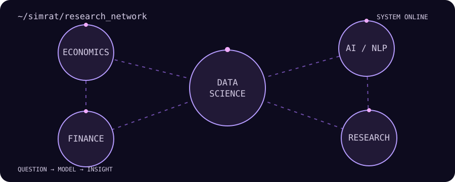

<div align="center">

  

  

  <p>
    <a href="https://www.linkedin.com/in/simrat-khalsa/">
      
    </a>
    <a href="https://github.com/simrat28701">
      
    </a>
  </p>

</div>
  
## 🧬 `whoami`

```python id="vs8n2q"
simrat = {
    "location": "Marseille, France",
    "education": "MSc Economics & Data Science",
    "universities": [
        "Aix-Marseille University",
        "University of Kent",
        "Virginia Tech"
    ],
    "interests": [
        "Econometrics",
        "Machine Learning",
        "Quantitative Finance",
        "AI & Consumer Intelligence"
    ],
    "currently_building": [
        "Nuance: AI Consumer Intelligence",
        "Airline Delay Econometrics"
    ],
    "exploring": "Social Sentiment × Stock Markets",
    "opportunities": "2027 internships",
    "motto": "Question assumptions. Test hypotheses. Build."
}
```
<div align="center">
  
</div>
<h2>📊 The Data Behind the Code</h2>

<div align="center">

  

  

</div>

<h2>🚀 The Project Laboratory</h2>

<table>
  <tr>
    <td width="50%" valign="top">
      <h3>🧠 NUANCE</h3>
      <b>AI-Powered Consumer Intelligence</b>
      <p>
        An NLP prototype that uncovers nuanced customer
        sentiment, product trade-offs and purchase intent.
      </p>
      <p>
        <code>Python</code>
        <code>LLMs</code>
        <code>Flask</code>
        <code>NLP</code>
      </p>
      
    </td>
    <td width="50%" valign="top">
      <h3>✈️ FLIGHT DELAY INTELLIGENCE</h3>
      <b>Econometrics & Predictive Modeling</b>
      <p>
        Studying US aviation delay patterns,
        operational risk and predictive methods
        using real-world flight data.
      </p>
      <p>
        <code>Econometrics</code>
        <code>Regression</code>
        <code>Python</code>
      </p>
      
    </td>
  </tr>
  <tr>
    <td width="50%" valign="top">
      <h3>📈 MARKET MOOD</h3>
      <b>Social Sentiment × Financial Markets</b>
      <p>
        Exploring the relationship between social media
        sentiment and stock market movements.
      </p>
      <p>
        <code>NLP</code>
        <code>Time Series</code>
        <code>Finance</code>
      </p>
      
    </td>
    <td width="50%" valign="top">
      <h3>🔬 RESEARCH ARCHIVE</h3>
      <b>Experiments, Models & More</b>
      <p>
        Econometric experiments, machine learning
        explorations and analytical projects.
      </p>
      <a href="https://github.com/simrat28701?tab=repositories">
        
      </a>
    </td>
  </tr>
</table>

<h2>🛠️ My Toolkit</h2>

<div align="center">

  

  <p>
    
    
    
    
  </p>

</div>

<div align="center">

  <h3>Curiosity is my favorite algorithm.</h3>

  <p>
    <i>Currently building, learning and looking for
    interesting problems worth solving.</i>
  </p>

  

</div>


